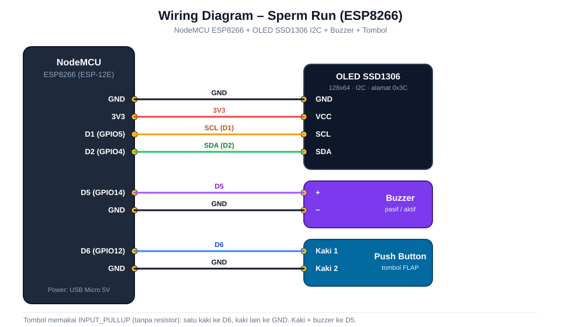

# 🎮 Sperm Run – Game OLED ESP8266

Game ala *Flappy Bird* yang dimainkan dengan **satu tombol** di layar **OLED SSD1306 128x64**, dijalankan oleh **NodeMCU ESP8266**. Karakternya sel sperma dengan ekor bergelombang. Ada animasi intro, efek suara lewat buzzer, skor, dan animasi saat game over.

## ✨ Fitur

- Layar OLED 128x64 (I2C) dengan animasi intro dan animasi game over
- Kontrol satu tombol (tekan untuk terbang naik, lepas untuk jatuh)
- Efek suara buzzer: lompat, nilai bertambah, dan crash
- Skor bertambah setiap berhasil melewati rintangan
- Posisi celah rintangan diacak setiap putaran

## 🕹️ Cara Bermain

1. Nyalakan alat dan tunggu animasi intro selesai sampai muncul tulisan **Press Button**.
2. Tekan tombol untuk mulai.
3. Tekan tombol untuk terbang naik, lepas untuk jatuh. Lewati celah di antara rintangan.
4. Menabrak rintangan atau menyentuh batas atas/bawah layar berarti game over. Skor akhir ditampilkan, lalu animasi penutup, lalu kembali ke intro.

## 🧰 Komponen

| No | Komponen | Jumlah | Keterangan |
|----|----------|--------|------------|
| 1 | NodeMCU ESP8266 (ESP-12E) | 1 | Mikrokontroler |
| 2 | OLED SSD1306 0.96" I2C (4 pin) | 1 | Alamat I2C `0x3C` |
| 3 | Buzzer (pasif disarankan) | 1 | Efek suara |
| 4 | Push button | 1 | Tombol kontrol |
| 5 | Kabel jumper + breadboard | secukupnya | |
| 6 | Kabel USB Micro (data) | 1 | Upload program + catu daya |

## 🔌 Wiring



| NodeMCU | Perangkat | Pin perangkat |
|---------|-----------|---------------|
| 3V3 | OLED SSD1306 | VCC |
| GND | OLED SSD1306 | GND |
| D1 (GPIO5) | OLED SSD1306 | SCL |
| D2 (GPIO4) | OLED SSD1306 | SDA |
| D5 (GPIO14) | Buzzer | + (positif) |
| GND | Buzzer | − (negatif) |
| D6 (GPIO12) | Push button | Kaki 1 |
| GND | Push button | Kaki 2 |

Catatan:
- Tombol memakai `INPUT_PULLUP`, jadi **tidak perlu resistor**. Cukup satu kaki ke D6 dan kaki lainnya ke GND.
- NodeMCU punya beberapa pin GND. Boleh memakai pin GND mana saja, atau jalur GND breadboard.
- Pada buzzer aktif, nada tetap sama untuk semua efek. Pada buzzer pasif, nadanya bervariasi.

## 📁 Struktur Repository

```
sperm-run/
├── Sperm_Run/
│   └── Sperm_Run.ino      # Program utama (sketch Arduino)
├── docs/
│   └── wiring-diagram.svg
└── README.md
```

Nama folder sketch harus sama dengan nama file `.ino` (aturan Arduino IDE), jadi `Sperm_Run/Sperm_Run.ino`.

## 🛠️ Langkah Pemasangan

### 1. Rakit perangkat keras

1. Pasang OLED: VCC→3V3, GND→GND, SCL→D1, SDA→D2.
2. Pasang buzzer: kaki positif→D5, kaki negatif→GND.
3. Pasang tombol: satu kaki→D6, kaki lain→GND.
4. Periksa lagi semua kabel dengan tabel wiring sebelum menyambungkan USB.

### 2. Siapkan Arduino IDE

1. Install [Arduino IDE](https://www.arduino.cc/en/software).
2. Buka **File → Preferences**, lalu isi *Additional Boards Manager URLs*:
   ```
   http://arduino.esp8266.com/stable/package_esp8266com_index.json
   ```
3. Buka **Tools → Board → Boards Manager**, cari **esp8266**, lalu install.
4. Install library lewat **Library Manager**:

   | Library | Pembuat |
   |---------|---------|
   | Adafruit GFX Library | Adafruit |
   | Adafruit SSD1306 | Adafruit |
   | Adafruit BusIO | Adafruit (otomatis ikut terinstall) |

   `Wire` dan `math.h` sudah bawaan.

### 3. Upload program

1. Buka `Sperm_Run/Sperm_Run.ino` di Arduino IDE.
2. Atur **Tools**:
   - Board: `NodeMCU 1.0 (ESP-12E Module)`
   - Upload Speed: `115200`
   - Port: sesuai port NodeMCU
3. Klik **Upload**.

### 4. Uji coba

1. Setelah upload selesai, layar menampilkan animasi intro **SPERM RUN**, lalu **Press Button**.
2. Tekan tombol untuk mulai bermain.
3. Jika layar kosong, buzzer diam, atau tombol tidak merespons, lihat bagian Troubleshooting.

## ⚙️ Pengaturan Game

Parameter ada di bagian atas `Sperm_Run/Sperm_Run.ino`:

```cpp
#define BUTTON_PIN D6
#define BUZZER_PIN D5

float gravity      = 0.26;   // makin besar, makin cepat jatuh
float flapStrength = -3.4;   // makin negatif, makin kuat naik
int   pipeGapSize  = 34;     // lebar celah rintangan (makin besar makin mudah)
```

Kecepatan rintangan diatur lewat `pipeX -= 3;` di dalam `loop()`.

## 🩺 Troubleshooting

| Masalah | Penyebab / solusi |
|---------|-------------------|
| Layar OLED kosong | Cek kabel SDA/SCL. Jika alamat I2C modul `0x3D`, ganti `0x3C` di `display.begin(...)`. Gunakan sketch *I2C Scanner* untuk memastikan. |
| Layar kosong dan program berhenti | Jika OLED tidak terdeteksi, program berhenti di `while (true);`. Periksa wiring OLED. |
| Tombol tidak merespons | Pastikan satu kaki ke D6 dan kaki lain ke GND. |
| Buzzer tidak bunyi | Cek polaritas (+ ke D5, − ke GND). Pada buzzer aktif, nada tidak bervariasi. |
| Upload gagal | Pilih port yang benar, gunakan kabel USB data (bukan kabel charge saja), tutup Serial Monitor. |

## 📜 Lisensi

Tambahkan file `LICENSE` sesuai kebutuhan (misalnya MIT).

---

Created by Kusuma
